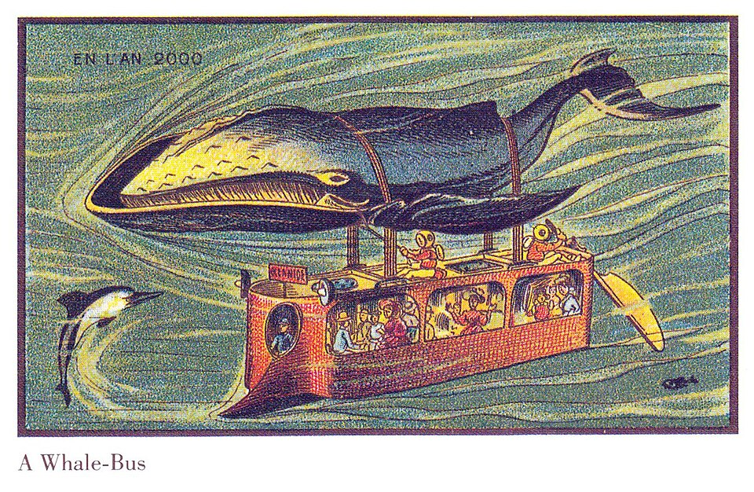

# 百年前，人们画出的未来

> 1804–1929 年间，15 个国家／地区的人怎样想象「以后的人怎么过日子」——一份带图注的档案式视觉图册。

**在线浏览**：https://dolomitiaugust.github.io/lost-futures-atlas/
（备用入口：https://lost-futures-atlas.app.workbuddy.host/?sharecode=YVLMLREKNC）



## 怎么浏览

整页**只按生活领域（16 个主题）组织**，用上方的主题按钮或左侧目录跳转；**不按国家筛选**。国家信息放在每张图的国家标签里，以及每个领域开头的「涉及哪些国家」一行——这样既能一眼看出同一主题里各国想法的差异，也不会出现选了某个国家后留下一堆空章节。

- 主题按钮与目录联动：选中某领域后目录高亮该项，其余置灰；**下滑时常驻页眉只保留主题切换条**，方便随时切换模块。主题较多，桌面铺成 2–3 行一次看全，平板 2 行、手机 3 行矩阵可横向滑动。按钮上的 `01`–`16` 是卷宗号（等宽弱化），悬停／长按可看到该卷宗的完整名称与图数；按钮上不再标含义不明的上标数字。当前领域／图数／AI 补绘数、深色切换与「显示全部领域」按钮都随页面滚动，不占页眉；国家信息放在每张图的标签和每章开头的「涉及哪些国家」一行。
- 目录按四卷编排（Ⅰ 行与居、Ⅱ 身与日、Ⅲ 群与世、Ⅳ 时与外）：每条含卷宗号、主题名和一句**独立的卷内提要**（不是章节标题的复述，例如「鲸鱼拉公交，海底打槌球」「1878 年就有人画出了视频通话」）；顶部「当前卷宗」卡片随选择联动，显示该卷提要、图数与涉及国家数。手机端是可展开的同样目录。
- 点击任意图片可放大；**默认是深色档案室**，右上角「☀ 纸色」可切换到泛黄档案纸（选择会被记住）。
- 桌面为三／四列网格、左侧常驻目录；手机为单列、目录折叠成可展开面板，筛选条可横向滑动。页眉右上角的小圆钮可随时切换纸色／深色，滚到深处也能用；页面右下角有「回到顶部」。

## 可用性与分享

- **搜索**：页眉下方的搜索框可检索标题、画面说明、国家与年代；搜索时跨全部卷宗显示命中图像，清空后回到原主题。
- **可分享的主题链接**：选中主题会写成 `?theme=ch09`（搜索为 `?q=…`），可直接分享给别人，浏览器后退也能回到上一次选择。
- **分享预览**：页面带 `description`、`og:*`、`twitter:*` 元信息与 `favicon.svg`，转发到社交平台会显示标题、摘要与《鲸鱼巴士》缩略图。
- **不阻塞的字体**：Google Fonts 改为异步加载（`media="print"` + `onload`），外部字体不可达时立即用系统字体栈渲染，不会白屏。
- **键盘与读屏**：所有按钮带 `type` 与 `:focus-visible` 焦点环；125 张图的 `alt` 完整，4 张 AI 补绘的 `alt` 明确带「AI 补绘（非历史原图）」前缀；放大层支持 Esc 关闭并把焦点还给原按钮。

## 视觉与字体

界面按「风尘档案馆」重做：泛黄纸张与灰尘纹理、旧档案卡（打孔、卷宗章、档号）、褪色墨色与印章红。每张卡片带一个等宽字体的档号（如 `AT-1900-005`）。

字体按 **Anthropic 官网的层级规范**映射到开源等价字体（Anthropic 的 Anthropic Serif / Sans / Mono 为私有字体，不可直接使用）：

| 角色 | 官方 | 本页映射 |
|---|---|---|
| 大标题、阅读 | Anthropic Serif / Copernicus | Newsreader → Source Serif 4 → Lora → Noto Serif SC |
| UI、正文、标签 | Anthropic Sans / StyreneB | Inter → Source Sans 3 → Noto Sans SC |
| 档号、年代、编号 | Anthropic Mono | JetBrains Mono → IBM Plex Mono → Consolas |

遵循官方规范：标题一律 400 字重且带负字距，正文无衬线 400，标签 500/600 带字距；中文用 Noto Serif SC（衬线标题）与 Noto Sans SC（界面正文）。字号按 76 / 38 / 23 / 18 / 15 / 13 / 11px 的阶梯拉开，元信息（国家、年代、档号、来源）用更淡的墨色，让文字量大的页面里重点自己跳出来。拉丁字体通过 Google Fonts 加载，离线时自动回退到系统字体栈。

## 内容规模

- **16 个生活领域**：出门、城市、地面交通、海洋、家务照护、饮食农业能源、课堂办公、通信媒体、医疗身体、娱乐体育、战争秩序、地方想象、非欧洲的另一种未来、更早的十九世纪、星空、他们没想到的。
- **125 幅图像**，每张标注国家、年代、画面说明与原始馆藏页链接；全页**无重复图像**（每条史料只出现一次）。
- **15 个国家／地区**：法国、德国、英国、意大利、俄国、美国、奥地利、波兰、澳大利亚、日本、中国、南亚、土耳其、墨西哥，另有少量未署国别馆藏。

## 关于 AI 补绘

少数主题只有文字记载、找不到可公开发布的历史图像，因此用**当时当地的画风**补绘了 4 张示意图，逐张加了醒目的「AI 风格补绘 · 非历史原图」标签，并写明**为何补绘**、**风格依据**与**文字史料出处**。它们不是史料，不与历史原图混同，可由读者自行判断是否保留。

| 图像 | 缺图原因 | 风格依据 |
|---|---|---|
| 南亚《苏丹娜的梦》(1905) | 乌托邦小说无同期插图 | 1905 年孟加拉／英属印度手工上色石版画＋Company School 细密画 |
| 土耳其《Resimli Ay》(1924) | 画报常转载国外插图，无确认原创可发布原图 | 1920 年代土耳其画报黑白钢笔线刻＋淡彩，保留清真寺天际线 |
| 墨西哥 Mujica 百层城 (1929) | 原图为展览／建筑新闻外部链接，权利待确认 | 1920 年代装饰艺术建筑表现图，阶梯式金字塔塔楼 |
| 中国《绘图新中国》(1910) | 小说有文字描写，未见可再发布同期插图 | 晚清《点石斋画报》式墨线白描、平远构图、宣纸底色 |

## 去重与参考仓库

内容曾与另一个仓库 [`past-futures-archive`](https://github.com/DolomitiAugust/past-futures-archive) 交叉核对：用感知哈希比对 106 张参考图，其中 **64 张是同一批法国／德国卡片的重复**（文件名不同），未重复搬运；只补入真正独有的中国《点石斋画报》、俄国 1914 年明信片与美英早期杂志图。

两库"说的是同一个东西"的对照（镭取暖、空中网球、机器人乐团、鲸鱼巴士、自动人行道、制造天气、飞行机器、圣埃利亚车站等 15 组）已核对。本页还合并了同一事物的不同版本条目：**Minerva 气球飞船**（1804 彩色版 / 1864 线描版）、**Ariel 空中蒸汽马车**（两幅版画）各并作一条；并清除同一张图跨章节重复出现与空占位条目。

## 图像来源与权利

历史图像来自 Wikimedia Commons 的 `Futuristic postcards`、`France / Germany / Moscow in XXI·XXIII Century (fiction)`、`Future in art` 等分类，以及法国国家图书馆（BnF）、美国国会图书馆、Wellcome Collection、日本国立国会图书馆、巴伐利亚州立图书馆的数字化馆藏。每张图下方的「原始馆藏页与版权」可回溯到具体文件页；原作年代在 1804–1929 之间，均属公有领域或权利状态已在该页标注。AI 补绘图下方改为「文字史料与出处」，指向对应的原著、研究或档案记录。

文字考据参考：The Public Domain Review《Lost Futures》、Asimov《Futuredays》(1986)、上海图书馆「未来之未来」展报道、《点石斋画报》与晚清科学小说研究、村井弦斋 1901 年《二十世纪的预言》、末广重恭《二十三年未来記》(1885)、梁启超《新中国未来记》(1902)、陆士谔《绘图新中国》(1910)、罗凯亚《苏丹娜的梦》(1905)。

## 目录结构

```
index.html          图册主页面（单文件，含样式与脚本）
images/             125 幅图像（页面实际引用到的部分）
.nojekyll           让 GitHub Pages 跳过 Jekyll、直接静态托管
README.md           本文件
```

本地 `images/` 中另有若干未被页面引用的素材与 AI 原始 PNG，未纳入仓库。

## 本地打开与更新

直接双击 `index.html`；或 `python -m http.server 8000` 后访问 `http://localhost:8000`。图片使用相对路径 `images/...`，两种方式都能显示，无需构建、无依赖。

```bash
git add -A
git commit -m "说明改了什么"
git push
```

GitHub Pages 监听 `main` 分支根目录，推送后约 1 分钟自动重新构建。
